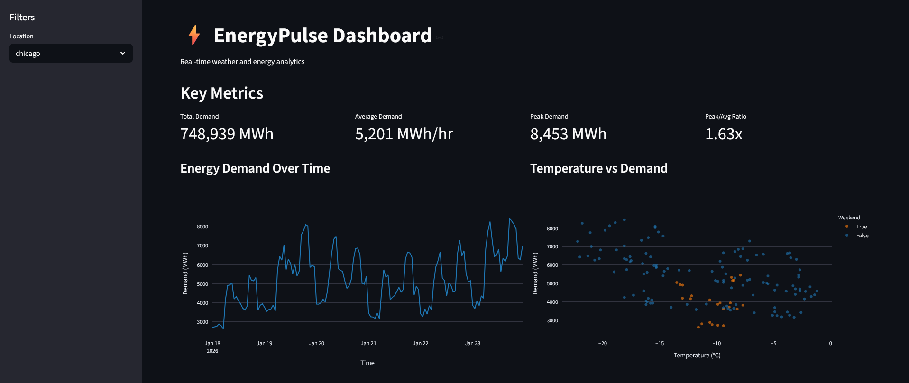
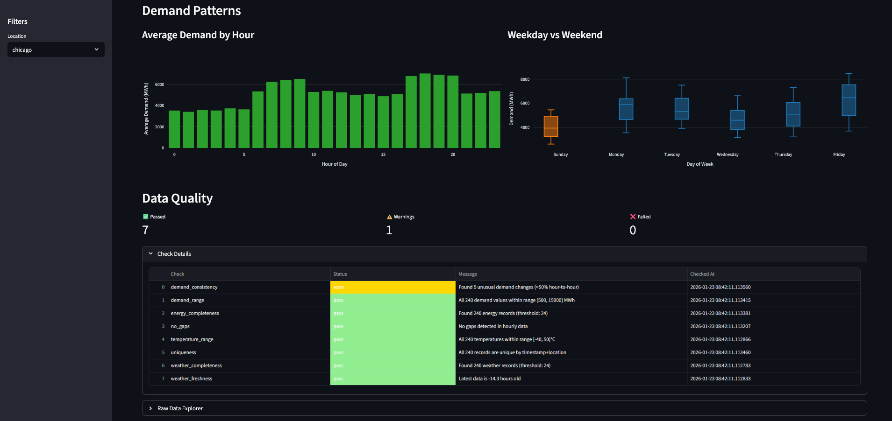

# EnergyPulse

Weather + simulated energy demand pipeline: fetches weather data, simulates demand, runs
quality checks, computes metrics and shows them in a dashboard. Python, httpx, DuckDB, Typer,
Streamlit, Plotly.




```
Weather API → Quality Checks → Metrics → Streamlit Dashboard
                    ↓
                 DuckDB
```

This file is the reference: what exists and how it works. `RUNBOOK.md` is the procedures,
`CLAUDE.md` the agent rules, `TASK.md` the open items.

## What it is

```
┌─────────────┐     ┌─────────────┐     ┌─────────────┐     ┌─────────────┐
│   Weather   │────▶│   Quality   │────▶│   Metrics   │────▶│  Dashboard  │
│   Ingestion │     │   Checks    │     │   Engine    │     │  (Streamlit)│
└─────────────┘     └─────────────┘     └─────────────┘     └─────────────┘
       │                   │                   │                   │
       └───────────────────┴───────────────────┴───────────────────┘
                                    │
                              ┌─────▼─────┐
                              │  DuckDB   │
                              │  Storage  │
                              └───────────┘
```

- **Python 3.11+** with strict type hints
- **Pydantic 2** for data validation
- **DuckDB** for local analytics storage
- **httpx** for async-capable HTTP
- **Typer + Rich** for CLI
- **Streamlit + Plotly** for dashboard
- **structlog** for structured logging
- **pytest** for testing

## Why it exists

A small end-to-end pipeline, from a public API to a dashboard, with every stage in one repo.

**Why simulate energy data?**
Real energy grid data requires registration/agreements. Simulation lets us demonstrate the full pipeline while showing domain knowledge (HVAC load curves, time-of-day patterns, weekend effects).

**Why DuckDB?**
Embedded OLAP database perfect for analytics workloads. No server setup, great Python integration, fast columnar queries.

**Why Open-Meteo?**
Free API, no registration required, historical data available. Perfect for portfolio projects.

## Quick start

```bash
cd energypulse

# Install dependencies
uv sync

# Run the full pipeline (ingest → quality → metrics)
uv run energypulse run --location new_york --days 7

# Launch the dashboard
uv run streamlit run src/energypulse/dashboard/app.py
```

## Commands

All run as `uv run energypulse <command>`. The table is regenerated from `energypulse --help`
by the doc check; edit the help strings in `src/energypulse/cli.py`, not this table.

<!-- generated:commands start -->
<!-- do not hand-edit: regenerated by doc-check --fix -->
| Command | What it does |
|---|---|
| `energypulse ingest` | Ingest weather data and simulate energy demand. |
| `energypulse quality` | Run data quality checks. |
| `energypulse metrics` | Compute and display energy metrics. |
| `energypulse run` | Run the full pipeline: ingest → quality → metrics. |
| `energypulse status` | Show pipeline status and data summary. |
<!-- generated:commands end -->

`ingest` and `run` take `--location` (new_york, los_angeles, chicago, houston, phoenix) and
`--days`; `metrics` takes `--location` as a filter. Every command takes `--db-path` (default
`data/energypulse.duckdb`). The dashboard is not a CLI command:

| Command | Does |
|---|---|
| `uv run streamlit run src/energypulse/dashboard/app.py` | the Streamlit dashboard over the same database |

## How it works

### 1. Data ingestion

Fetches weather data from [Open-Meteo API](https://open-meteo.com/) (free, no API key required) and simulates correlated energy demand.

```bash
uv run energypulse ingest --location chicago --days 14
```

Each city is queried in its own timezone, so timestamps are local wall-clock time and
hour-of-day patterns line up across cities.

The energy simulator models realistic demand patterns:
- Temperature-driven HVAC load (heating in cold, cooling in heat)
- Time-of-day patterns (morning ramp, evening peak, overnight valley)
- Weekend reduction (commercial buildings closed)

### 2. Quality checks

```bash
uv run energypulse quality
```

**Checks performed** (9 total, 5 on weather and 4 on energy):
| Check | Description |
|-------|-------------|
| `weather_completeness` | At least 24 weather records |
| `weather_freshness` | Most recent weather data within 48 hours |
| `temperature_range` | Values within -40°C to 50°C |
| `weather_uniqueness` | No duplicate timestamp+location pairs in weather |
| `no_gaps` | No missing hours in the weather time series |
| `energy_completeness` | At least 24 energy records |
| `demand_range` | Energy demand within 500-15,000 MWh |
| `energy_uniqueness` | No duplicate timestamp+location pairs in energy |
| `demand_consistency` | No >50% hour-to-hour spikes |

### 3. Semantic metrics

```bash
uv run energypulse metrics --location new_york
```

**Metrics computed**:
| Metric | Description |
|--------|-------------|
| `total_demand` | Sum of hourly demand (MWh) |
| `peak_demand` | Maximum hourly demand |
| `average_demand` | Mean hourly demand |
| `peak_hour_ratio` | Peak / Average (load variability) |
| `weekend_weekday_ratio` | Weekend avg / Weekday avg |
| `peak_hour_demand` | Average during 5-8 PM |
| `overnight_minimum` | Average during 12-5 AM (base load) |
| `temperature_sensitivity` | Correlation between temp and demand |

### 4. Dashboard

Interactive Streamlit dashboard with:
- Key metrics summary (total, peak, average demand)
- Time series of energy demand
- Temperature vs demand scatter plot
- Hourly demand patterns
- Weekday vs weekend comparison
- Data quality status

### Sample output

From `uv run energypulse run --location new_york --days 7` on 2026-10-07. The quality table:

```
┏━━━━━━━━━━━━━━━━━━━━━━┳━━━━━━━━┳━━━━━━━━━━━━━━━━━━━━━━━━━━━━━━━━━━━━━━━━━━━━━━━━━━━━━┓
┃ Check                ┃ Status ┃ Message                                             ┃
┡━━━━━━━━━━━━━━━━━━━━━━╇━━━━━━━━╇━━━━━━━━━━━━━━━━━━━━━━━━━━━━━━━━━━━━━━━━━━━━━━━━━━━━━┩
│ weather_completeness │ PASS   │ Found 192 weather records (threshold: 24)           │
│ weather_freshness    │ PASS   │ Latest data is -7.3 hours old                       │
│ temperature_range    │ PASS   │ All 192 temperatures within range [-40, 50]°C       │
│ weather_uniqueness   │ PASS   │ All 192 records are unique by timestamp+location    │
│ no_gaps              │ PASS   │ No gaps detected in hourly data                     │
│ energy_completeness  │ PASS   │ Found 192 energy records (threshold: 24)            │
│ demand_range         │ PASS   │ All 192 demand values within range [500, 15000] MWh │
│ energy_uniqueness    │ PASS   │ All 192 records are unique by timestamp+location    │
│ demand_consistency   │ WARN   │ Found 4 unusual demand changes (>50% hour-to-hour)  │
└──────────────────────┴────────┴─────────────────────────────────────────────────────┘
```

A pass count follows the table. The forecast endpoint returns the rest of today's hours too,
which is why the record count is 192 (8 days) and the freshness age is negative.

The metrics table:

```
┏━━━━━━━━━━━━━━━━━━━━━━━━━┳━━━━━━━━━━━━┳━━━━━━━━━━━━━┓
┃ Metric                  ┃      Value ┃ Unit        ┃
┡━━━━━━━━━━━━━━━━━━━━━━━━━╇━━━━━━━━━━━━╇━━━━━━━━━━━━━┩
│ total_demand            │ 930,160.62 │ MWh         │
│ peak_demand             │   7,684.76 │ MWh         │
│ average_demand          │   4,844.59 │ MWh         │
│ peak_hour_ratio         │       1.59 │ ratio       │
│ weekend_weekday_ratio   │       0.74 │ ratio       │
│ peak_hour_demand        │   6,464.36 │ MWh         │
│ overnight_minimum       │   3,383.91 │ MWh         │
│ temperature_sensitivity │       0.16 │ correlation │
└─────────────────────────┴────────────┴─────────────┘
```

## Layout

```
src/energypulse/
├── ingestion/        # Weather API + energy simulation
│   ├── weather.py    # Open-Meteo client
│   └── energy.py     # Demand simulator
├── quality/          # Data quality checks
│   └── checks.py     # Check implementations
├── metrics/          # Semantic metrics layer
│   └── definitions.py
├── dashboard/        # Streamlit app
│   └── app.py
├── models.py         # Pydantic data models
├── storage.py        # DuckDB persistence
└── cli.py            # Typer CLI
tests/                # pytest test suite
data/                 # DuckDB database (gitignored)
pyproject.toml
```

## Outside the repo

| Thing | Where | Notes |
|---|---|---|
| Weather | [Open-Meteo](https://open-meteo.com/) archive and forecast endpoints | free, no key; the only network call |

## Development

pytest, ruff and mypy live in the `dev` extra, which plain `uv sync` does not install.

```bash
# Install runtime deps plus the dev extra
uv sync --all-extras

# Lint and types
uv run ruff check . && uv run ruff format --check . && uv run mypy src/

# Run all tests
uv run pytest

# With coverage
uv run pytest --cov=energypulse --cov-report=term-missing

# Run specific test file
uv run pytest tests/test_quality.py -v
```

CI runs the same lint and tests. Licensed MIT (`LICENSE`).

## Pointers

- `RUNBOOK.md`: run, refresh the data, release, restore.
- `CLAUDE.md`: the agent rules.
- `TASK.md`: what is open.
- `~/developer/hq/CONVENTIONS.md`: the portfolio release and commit rules.
